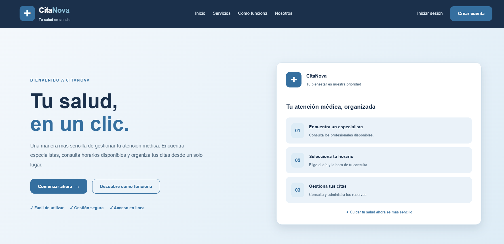
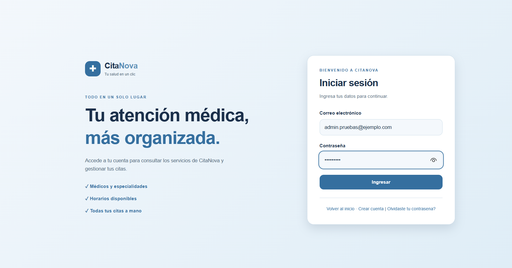
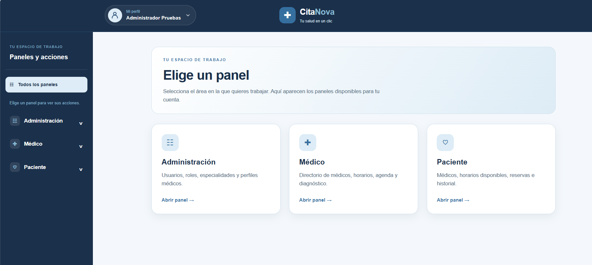
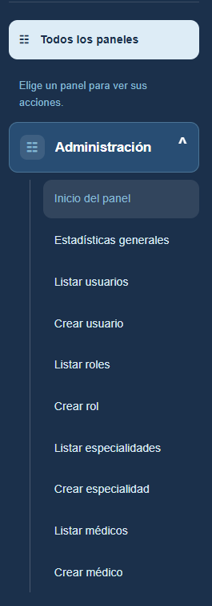
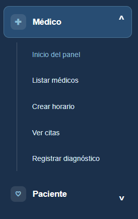
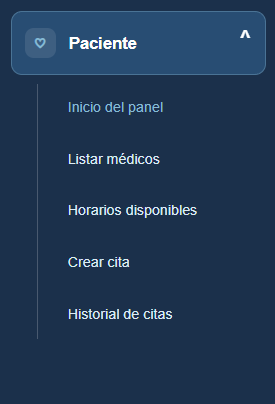
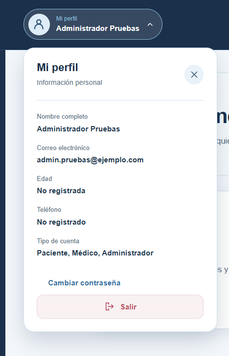
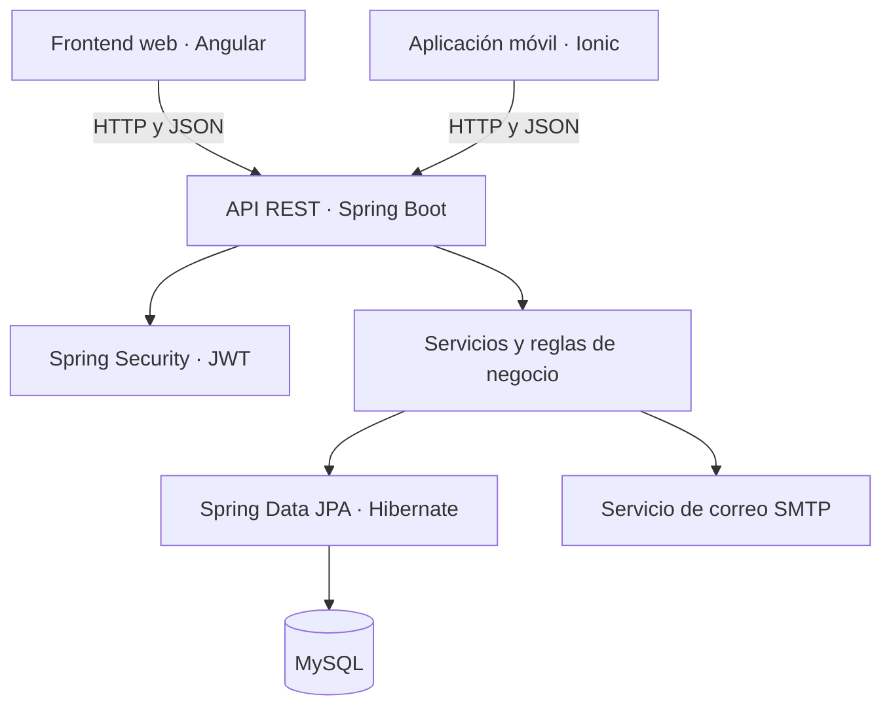

<div align="center">


#  CitaNova

### Tu salud en un clic.

**Sistema de gestión de citas médicas · Plataforma web y móvil**

Proyecto académico de **Programación II** · Ingeniería en Sistemas · Universidad Mariano Gálvez de Guatemala.

[](https://www.java.com/)
[](https://spring.io/projects/spring-boot)
[](https://angular.dev/)
[](https://ionicframework.com/)
[](https://www.mysql.com/)

[](https://github.com/nathanv-web/proyecto-citas-fase1/stargazers)
[](https://github.com/nathanv-web/proyecto-citas-fase1/issues)
[](https://github.com/nathanv-web/proyecto-citas-fase1/pulls)

[** Funcionalidades**](#funcionalidades) · [** Galería**](#galeria) · [** Instalación**](#instalacion) · [** API**](#api) · [** Equipo**](#equipo)

</div>

---

<a id="presentacion"></a>
##  Conoce CitaNova

CitaNova es una aplicación que permite organizar el proceso de atención médica desde un solo lugar. Los pacientes pueden explorar médicos y especialidades, consultar horarios, reservar citas y revisar su historial. Los profesionales gestionan sus agendas, mientras que los administradores controlan usuarios, roles y catálogos.

El sistema está compuesto por una **API REST en Spring Boot**, un **frontend web en Angular** y una **aplicación móvil con Ionic**.

<div align="center">
  <a href="docs/img/inicio.png">
    
  </a>
  <sub>Vista de bienvenida de la plataforma web</sub>
</div>

---

<a id="funcionalidades"></a>
##  Funcionalidades principales

|  Paciente |  Médico |  Administrador |
| :--- | :--- | :--- |
| Registro e inicio de sesión | Consulta de citas y agenda | Administración de usuarios |
| Buscar médicos y especialidades | Gestión de horarios según permisos | Administración de roles y permisos |
| Consultar horarios disponibles | Registro de diagnósticos | Gestión de especialidades |
| Reservar, cancelar y reprogramar citas | Notificaciones de nuevas reservas | Gestión de perfiles médicos |
| Consultar historial de citas | Visualización de disponibilidad | Estadísticas generales |

**Seguridad y comunicación:** autenticación JWT, permisos por rol, verificación y recuperación de cuenta por correo, notificaciones en el sistema y confirmaciones de reserva por correo electrónico.

> Las opciones disponibles en pantalla dependen de los roles y permisos asignados a cada cuenta.

---

<a id="galeria"></a>
##  Galería de CitaNova

### Acceso y panel principal

<table>
  <tr>
    <th width="50%"> Inicio de sesión</th>
    <th width="50%"> Selección de paneles</th>
  </tr>
  <tr>
    <td><a href="docs/img/login.png"></a></td>
    <td><a href="docs/img/paneles.png"></a></td>
  </tr>
</table>

### Módulos disponibles

<table>
  <tr><th> Administración</th><th> Médico</th><th> Paciente</th></tr>
  <tr>
    <td align="center"><a href="docs/img/menu-administrador.png"></a></td>
    <td align="center"><a href="docs/img/menu-medico.png"></a></td>
    <td align="center"><a href="docs/img/menu-paciente.png"></a></td>
  </tr>
  <tr>
    <td>Usuarios, roles, especialidades, médicos y estadísticas.</td>
    <td>Horarios, agenda, citas y diagnósticos.</td>
    <td>Médicos, horarios, reservas e historial.</td>
  </tr>
</table>

<details>
  <summary><strong> Ver captura del perfil de usuario</strong></summary>
  <br>
  <div align="center">
    <a href="docs/img/perfil.png"></a>
  </div>
</details>

> Las capturas corresponden a la **versión web** del proyecto durante el desarrollo. La aplicación móvil Ionic forma parte del repositorio; no se incluyen imágenes de ella porque todavía no contamos con capturas verificadas.

---

<a id="arquitectura"></a>
##  Arquitectura y tecnologías



| Área | Tecnologías utilizadas |
| :--- | :--- |
| Backend | Java 21, Spring Boot 4.1, Maven |
| API y seguridad | Spring Web MVC, Spring Security, JWT, validaciones |
| Persistencia | JPA, Hibernate, MySQL |
| Frontend web | Angular 22, TypeScript, HTML, CSS |
| App móvil | Ionic 9, Angular y Capacitor |
| Pruebas | JUnit, Mockito, JaCoCo, Postman |
| Versionamiento | Git y GitHub |

### Organización del repositorio

```text
proyecto-citas-fase1/
├── citas-backend/                  # API REST Spring Boot
│   ├── database/
│   │   ├── schema.sql              # Esquema inicial
│   │   ├── data.sql                # Datos de ejemplo
│   │   └── migrations/             # Migraciones posteriores
│   ├── src/main/java/             # Código de la aplicación
│   ├── src/test/java/             # Pruebas automatizadas
│   └── pom.xml
├── citas-frontend/                 # Aplicación web Angular
├── citas-ionic/                    # Aplicación móvil Ionic
├── docs/
│   └── img/                       # Capturas y logo del README
└── README.md                       # Documentación general
```

También puedes consultar la [documentación del frontend](citas-frontend/README.md).

---

<a id="instalacion"></a>
##  Instalación y ejecución local

### Requisitos previos

- **JDK 21** y Git.
- **MySQL 8** o una versión compatible.
- **Node.js y npm** compatibles con las versiones de Angular/Ionic del proyecto.
- Opcional: MySQL Workbench, Postman y un servidor SMTP de prueba como Mailpit.

###  Clonar el proyecto

```bash
git clone https://github.com/nathanv-web/proyecto-citas-fase1.git
cd proyecto-citas-fase1
```

###  Preparar la base de datos

1. Crear o importar el esquema desde [`citas-backend/database/schema.sql`](citas-backend/database/schema.sql).
2. Revisar [`citas-backend/database/migrations/`](citas-backend/database/migrations/) y aplicar las migraciones que correspondan al estado de la base.
3. Si deseas poblar una instalación de demostración, revisar [`citas-backend/database/data.sql`](citas-backend/database/data.sql) antes de ejecutarlo.

**Importante:** realiza un respaldo antes de migrar una base de datos existente. El esquema inicial utiliza `citas_db`; en algunos equipos se utiliza `citas_db_actualizada`. La URL JDBC debe apuntar a la base realmente creada.

###  Configurar y arrancar el backend

El archivo `citas-backend/src/main/resources/application.properties` define la configuración de Spring. **Utiliza variables de entorno para sobreescribir las credenciales locales; nunca subas contraseñas ni claves JWT al repositorio.**

En **CMD de Windows**:

```cmd
set SPRING_DATASOURCE_URL=jdbc:mysql://localhost:3306/citas_db
set SPRING_DATASOURCE_USERNAME=TU_USUARIO_MYSQL
set SPRING_DATASOURCE_PASSWORD=TU_CONTRASENA_MYSQL
set JWT_SECRET=UNA_CLAVE_ALEATORIA_LARGA_Y_SEGURA
cd citas-backend
.\mvnw.cmd spring-boot:run
```

> Si utilizas `citas_db_actualizada`, sustituye el nombre en `SPRING_DATASOURCE_URL`. Estas variables de `set` corresponden a la terminal abierta, no son permanentes.

API local utilizada durante el desarrollo: **`http://localhost:8081`**.

###  Iniciar el frontend web

En otra terminal, desde la raíz del repositorio:

```bash
cd citas-frontend
npm ci
npm start
```

Por lo general, Angular abre en `http://localhost:4200`.

###  Iniciar la aplicación Ionic

En otra terminal:

```bash
cd citas-ionic
npm ci
npm start
```

La dirección del servidor de desarrollo dependerá de su configuración. Para ejecutar desde un dispositivo físico, puede ser necesario configurar el acceso a la API desde la red local.

###  Correo electrónico

El backend incluye envío de correo para funciones de identidad y confirmación de citas. Puedes configurar un SMTP de pruebas. En desarrollo se ha utilizado el puerto `1025` y, con Mailpit, normalmente se revisa la bandeja en `http://localhost:8025`.

---

<a id="api"></a>
##  API REST

Principales rutas del backend (prefijo local: `http://localhost:8081`):

| Método | Ruta | Descripción |
| :--- | :--- | :--- |
| `POST` | `/api/v1/auth/register` | Registrar usuario |
| `POST` | `/api/v1/auth/login` | Inicio de sesión y generación de JWT |
| `GET` | `/api/v1/medicos` | Consultar médicos |
| `GET` | `/api/v1/schedules/available` | Buscar horarios disponibles |
| `POST` | `/api/v1/appointments` | Reservar una cita |
| `GET` | `/api/v1/appointments/my-history` | Consultar historial de citas |
| `PUT` | `/api/v1/appointments/{id}/cancel` | Cancelar una cita |
| `PUT` | `/api/v1/appointments/{id}/reschedule` | Reprogramar una cita |
| `GET` | `/api/v1/appointments/my-agenda` | Consultar agenda médica |
| `GET` | `/api/v1/notifications` | Consultar notificaciones propias |
| `GET` | `/api/v1/notifications/unread-count` | Contar avisos no leídos |
| `PATCH` | `/api/v1/notifications/{id}/read` | Marcar un aviso como leído |

La mayoría de rutas de negocio requieren un JWT válido y los permisos correspondientes:

```http
Authorization: Bearer TU_TOKEN_JWT
```

No publiques tokens reales en archivos de ejemplo, capturas o colecciones Postman compartidas.

---

<a id="pruebas"></a>
##  Pruebas y calidad

La API incluye pruebas automatizadas con **JUnit y Mockito**, además de reportes de cobertura generados por **JaCoCo**.

Desde `citas-backend`, en Windows:

```cmd
.\mvnw.cmd clean test
```

Reporte HTML generado localmente:

```text
citas-backend/target/site/jacoco/index.html
```

En una medición durante el desarrollo se alcanzó **74% de cobertura de instrucciones y 54% de decisiones**. Estos son valores históricos y pueden cambiar al incorporar nuevas funcionalidades o pruebas; no se presentan como una métrica automática en tiempo real.

---

<a id="equipo"></a>
##  Equipo de desarrollo

Proyecto colaborativo desarrollado por estudiantes de Ingeniería en Sistemas de la **Universidad Mariano Gálvez de Guatemala**.

| Perfil | Integrante | GitHub |
| :---: | :--- | :--- |
|  | Ángel Gabriel Morales | [@amoralesm57-dev](https://github.com/amoralesm57-dev) |
|  | Jaime Danilo Velásquez | [@jvelasquezm35-ops](https://github.com/jvelasquezm35-ops) |
|  | Nathan Gadiel Piedrasanta | [@nathanv-web](https://github.com/nathanv-web) |
|  | América Alessandra Arias Chicas | [@aariasc2](https://github.com/aariasc2) |
|  | agonzalezr7 | [@agonzalezr7](https://github.com/agonzalezr7) |
|  | Julián Alejandro Roca Guerra | [@AlejandroGu8](https://github.com/AlejandroGu8) |

> **Nota:** el nombre completo del integrante `agonzalezr7` no aparecía en la captura compartida, por lo que se conserva su usuario de GitHub para evitar errores.

---

<div align="center">

###  CitaNova

**Tu salud en un clic.**

[Volver al inicio](#-citanova)

</div>
